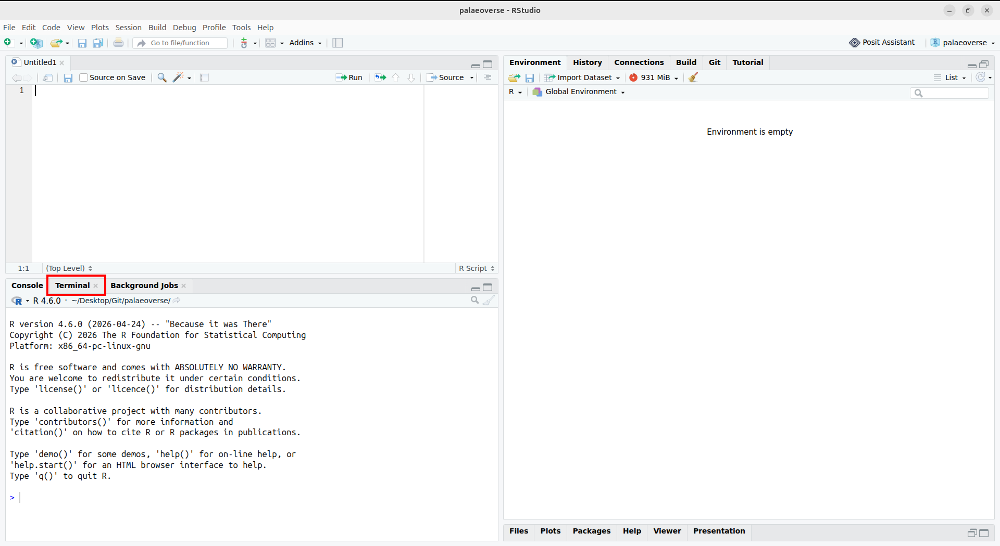
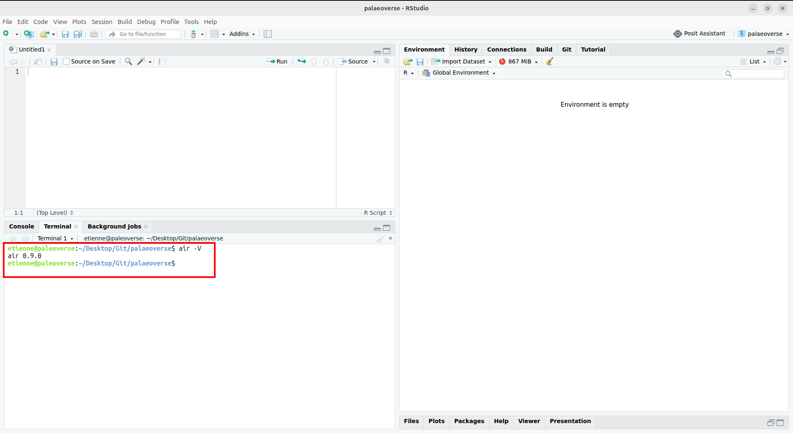
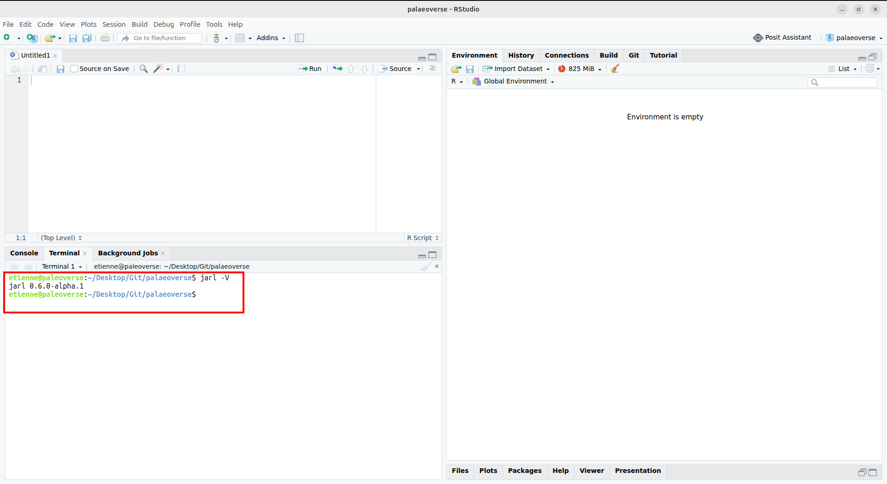
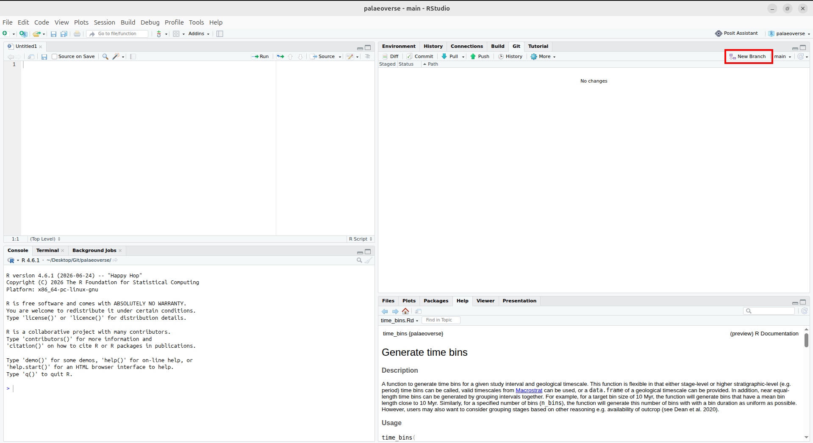
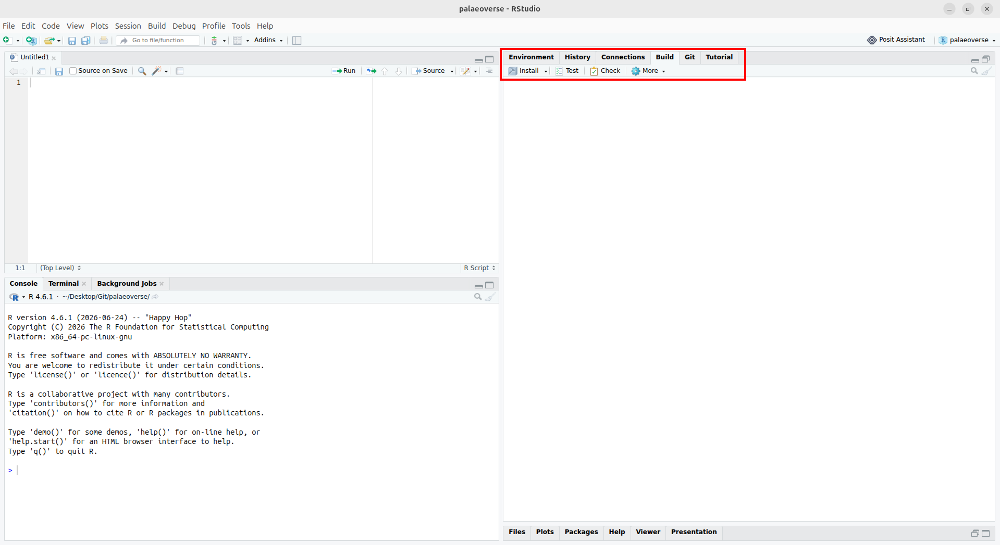
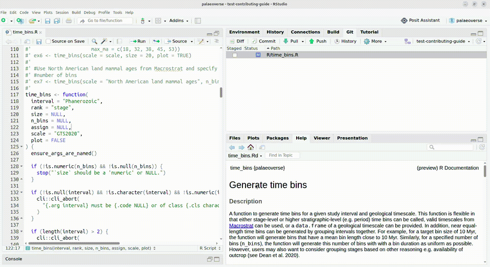

## Required tools

Besides R, you will need to use a variety of tools to ease the development process and to ensure that your contribution follows the Palaeoverse code standards. 

- R packages:  
    
  - [`devtools`](https://devtools.r-lib.org/): this contains many functions that make package development significantly easier  
  - [`pak`](https://pak.r-lib.org/): this provides some functions to install all dependencies of the package you want to contribute to. It is good to install optional dependencies because some tests or examples will use them.  
      
- Other tools (see screenshots below):  
    
  - [Air](https://posit-dev.github.io/air/): this is a code formatter, it ensures that all R code in the package follows a common style (e.g. it automatically adds whitespace or breaks lines where needed). You can install it from here: [https://posit-dev.github.io/air/cli.html](https://posit-dev.github.io/air/cli.html)   
      
    You might need to restart RStudio (or the IDE that you use, if you use one) after installing it. This tool runs in the terminal, not the R console. You can check that it is correctly installed by running `air -V` to print its version number. 

  - [Jarl](https://jarl.etiennebacher.com/): this is a code linter, it checks R code to find common mistakes or programming patterns that shouldn't be used because they are less readable, efficient, or prone to bugs. You can install it from here: [https://jarl.etiennebacher.com/#installation](https://jarl.etiennebacher.com/#installation)   
      
    You might need to restart RStudio (or the IDE that you use, if you use one) after installing it. This tool runs in the terminal, not the R console. You can check that it is correctly installed by running `jarl -V` to print its version number. 







- [Git](https://git-scm.com/): this is a version control tool, which is key in the software development process. It allows us to make and suggest changes to packages.  
    
- [Github](https://github.com/): this is the platform that stores the code for all of Palaeoverse. It also provides the interface to suggest, review, and implement code changes. [Create a Github account](https://github.com/signup) if you don't have one already.

You can check some of our [workshop materials](https://workshop.palaeoverse.org/2025-GSA-workshop/02_workflow/) to see how to get started with Git, Github, and RStudio. Alternatively, the book ["Happy Git and Github for the useR"](https://happygitwithr.com/) is a useful, and free, resource. In this tutorial, we assume that you have already done these steps.

The remainder of this guide requires you to be familiar with a few Git actions: cloning, committing, branching, and pushing.

## Get ready to contribute 

You need to have an idea of what you want to change in the package. This could be a typo to fix or a new function argument to implement, among other things. You can take a look at [all issues in Palaeoverse](https://github.com/search?q=org%3Apalaeoverse+is%3Aissue+is%3Aopen&type=issues) for inspiration. Note that almost all pull requests should refer to an issue (except for those that fix typos in the documentation for instance). If you can't find an existing issue that discusses the changes you want to make, create one and ensure that making a pull request (PR) is necessary before opening one.

Once you have installed the tools detailed above and know what you want to do, it is time to fork and clone the relevant repository so that you have a local copy you can modify. You can then create a new branch that very briefly summarizes the type of change, e.g. "fix-typo-palaeorotate" or "add-arg-XXX-lat-bins-degrees". Giving a readable name to a branch makes it easier to switch between branches in the future. It is also important to create a new branch early in the process so that we avoid pushing to "main" by mistake.



Once this is done, run `pak::local_install_dev_deps()` to install all packages used by this package (e.g. because they provide some functionality that is essential to the package, or because they help in the development process but are not strictly necessary for external users).

**Before we start:** contributing to an R package requires touching several files and understanding many concepts. It is absolutely fine to open PRs that are still work-in-progress and to ask for help where you are stuck. We are not expecting complete PRs from everyone.

Now that you have all development tools installed and created a new branch, you are ready to code!

## Case study: "Improved binning for time_bins"

In this section, we will use an existing merged pull request as a case study to see the various steps in the development process. More specifically, we will use PR [#131](https://github.com/palaeoverse/palaeoverse/pull/131) ("Improved binning for time_bins") of the palaeoverse package. You can open this link and go to the tab "Files changed" if you want to follow along. Note, this is a legacy PR and the function has evolved since this PR, it is only meant as an illustration for the contributing process.

The PR that we follow (["Improved binning for time_bins"](https://github.com/palaeoverse/palaeoverse/pull/131)) is a new feature: it adds the argument `n_bins` to `time_bins()` and improves this function's performance. If you check the "Files changed" tab on Github, you can see that four files were modified:

- ``man/time_bins.Rd``
- `R/time_bins.R`  
- `tests/testthat/test-time_bins.R`
- `NEWS.md`

We will explain these changes in more detail in the following subsections.

### Implement changes 

The first thing to do is to run `devtools::load_all()`. This will load the current version of the package in the session. This is extremely useful because it means that you can easily test changes you make: any time you change something in the code, run `devtools::load_all()` to load these changes and experiment with them. For now, we haven't touched anything, so this simply loads the latest version of the package.

At this point, steps to follow start diverging depending on what you want to do. If you want to fix a bug, you should first ensure that you can reproduce the bug in the current version of the package, before changing anything.

Here, the PR we follow is a new feature so we don't have to test anything before starting writing code. In this PR, the bulk of the work is done in `R/time_bins.R`: this file contains the implementation of `palaeoverse::time_bins()`, and is where the new argument is implemented and where the code is modified to improve the function's performance. This tutorial gives an overview of the development process so we will not go through all of the code here, but instead just highlight the major steps.  

::: {.callout-note title="About R packages' structure"}

R packages follow a strict structure and should at least have the following folders: 

- R: contains all the R code related to the functions provided by the package. The function documentation is usually stored in the same file as the code (this documentation consists of comments starting with `#'`). 
- man: this is short for "manual". It contains the final documentation exported by the package. This is the content that we see when we do `?mean` for instance. Files in this folder are automatically generated by `devtools::document()`, you shouldn't modify them by hand. 
- tests: contains the tests for all the functions in the package. 

Therefore, a pull request that improves the efficiency of a function but doesn't change anything from the user point of view will only modify files in the R folder. Conversely, adding a new function or a new argument requires changes in R, man, and tests. 

:::

### Ensure package-level robustness

Unlike when writing code for a research project, code contained in an R package must be stress-tested to ensure that users can only run it in the intended way. A key part of this is input error handling: these are checks that ensure that the values passed to our function arguments are appropriate for the downstream code.

Here, a new argument has been added to the function (`n_bins`), so we need to add error handling on this argument, specifically to ensure that a value has been provided, and that it is numeric.

```r
if (!is.numeric(n_bins) && !is.null(n_bins)) {  
  stop("`n_bins` should be a 'numeric' or NULL.")  
}  
```

Crafting robust error handling is difficult! Start by thinking about what characteristics are shared by a range of appropriate values, and what would exclude inappropriate values. You can look at how other functions check inputs and how existing tests cover a variety of wrong inputs for inspiration. Ultimately we will include the error handling in our review process, so we can help you to ensure that inappropriate values are caught.

**Note:** after this PR was merged, we added some helper functions to make input checking easier, e.g. `rlang::check_bool(x)` to ensure that `x` can only be `TRUE` or `FALSE`.

### Document changes 

Depending on the changes you have made, you might need to add documentation or modify existing ones. Function documentation uses `roxygen2`. This means that you can modify the documentation in the same R file where you made changes (here, `R/time_bins.R`) and then compile it to automatically produce 'manual' files in the man folder (here, `man/time_bins.Rd`). Function documentation starts with `#'` in the R file. For instance, we can see that the docs for the new argument were added here:

```r
#' @param n_bins \code{numeric}. For equal-length time bins, a   
#'   fixed number of time bins can be specified instead of a bin  
#'   `size`. This argument will be ignored if `size` is specified.  
```

Once you have made the required changes, use `devtools::document()` to compile the documentation. This automatically generates `man/time_bins.Rd`, you don't need to modify this file by hand! 

### Test changes

If your contribution consists of fixing a bug or implementing a new feature, then you must add tests, i.e. checks that assess whether a function works in the desired fashion. This is necessary to ensure that the bug will not go unnoticed again in the future, or that the feature behaves as you expect, especially when future modifications are made to the package.

Tests are implemented with the package [`testthat`](https://testthat.r-lib.org/). This broadly consists of two sets of functions:

- `test_that(...)` is the general block where you define the name of the test (i.e. what this block is supposed to test) and where you write the code to test and the expectations it is supposed to match;  
- `expect_*()` are functions that help define what should happen. There are many expectations possible, e.g. `expect_equal()` to test values, `expect_length()` to test the length of an object, and `expect_true()` to test that an assertion is true. See the full list [here](https://testthat.r-lib.org/reference/index.html#expectations).

You can find existing tests in `tests/testthat`. If you modified an existing function, then find the corresponding test file (tip: `usethis::use_test()` will open the corresponding test file). If you created a function, you should create a new test file. Here, the PR we follow added an argument to `time_bins()` so we need to add some tests to the existing file `tests/testthat/test-time_bins.R`.

You can run `devtools::test()` at any point in the development process to run the entire test suite. This is also helpful for finding bugs in new code, as it automatically flags when the code is not behaving as it should.

In RStudio, you can also use the button "Test" in the "Build" pane:



A good place to start is to try and throw errors from any new argument input error handling (and if you get an unexpected result, it's worth revisiting the error handling). Looking at files changed in this PR, we can see three types of changes:

1. This PR modified `time_bins()` to print a message when the number of bins is automatically determined, so this existing test:  
   ```r
   expect_equal(
     nrow(time_bins(interval = c("Phanerozoic"),  size = 25, rank = "stage")),
     22
   )  
   ```
   is now wrapped in `expect_message()`:  
   ```r
   expect_message(  
     expect_equal(
       nrow(time_bins(interval = c("Phanerozoic"),  size = 25, rank = "stage")),
       22
     )  
   )  
   ```
     
2. Tests for the new behavior when it is expected to work:  
   ```r
   # check that size- and n_bins-based bins are identical  
   expect_message({bins_n <- time_bins(n_bins = 11)})  
   expect_message({bins_size <- time_bins(size = 50)})  
   expect_equal(bins_n, bins_size)  
   ```

3. Tests for the new behavior when it is expected to fail:  
   ```r
   expect_error(time_bins(n_bins = 200))  
   ```

**Note:** this PR is slightly outdated in terms of coding practices. In particular, you should now use `expect_snapshot(<code>, error = TRUE)` instead of `expect_error(<code>)`.

Your pull request will not be merged until the code is adequately tested, with all tests passing. In general, we aim for at least 95% of code coverage for new functions. Note that an automated comment detailing the coverage of your PR and indicating which lines are not covered will be posted shortly after you open a PR (you can also use the package [`covr`](https://covr.r-lib.org/) to check this locally).

### All the rest 

We have now added a feature, added multiple tests, ensured that the entire test suite succeeds, and potentially added some extra documentation. We are almost done! But there are a few things left to do before opening a new pull request.

First, we should communicate our changes to the users (unless the contribution consists of typo fixes). This is done via the NEWS.md file, which contains the list of all changes that are relevant to external users (sometimes we make changes that improve the package but are invisible to the external users because they don't change any existing behavior). Depending on your change, add a bullet point in "New features" or "Bug fixes".

Second, we should ensure that our changes match the Palaeoverse standards in terms of code quality and styling. To do so, we can use two automated tools, Air and Jarl.  As mentioned in the "Required tools" section, the former automatically formats code, and the latter automatically searches for bad patterns of code. Run `air format .` and `jarl check .` in the terminal (not the R console). Air shouldn't error but it may happen that Jarl reports some errors, in which case you will have to fix them. It might be the case that running `jarl check . --fix` automatically fixes those errors.

Finally, run `devtools::check()`. This is a thorough checking function that includes `devtools::test()` but also runs a lot of other checks. 

If all checks pass, you are ready to create a PR!

### Make a new pull request 

Commit all your changes to your branch, and then push your branch. On the GitHub repository, you should now see a yellow block suggesting to "Compare and open a pull request". You can follow this button to prepare a PR. 



You will need to add a title and a PR description. Prepare a concise description that explains the new feature or the bug fix. Note that if this PR is related to an issue, you can add "Fixes #[ISSUE NUMBER]" or "Closes #1234" in the PR description (not the PR title) to automatically link the issue and PR, which will also close the issue 1234 when the PR is merged.

Once this is done, you can open the pull request. This triggers a list of automated checks to run tests, check formatting, etc. Some of these checks will post an automated comment in case of failure, explaining the issue and how to solve it. If this is not the case, you will need to open their logs and investigate why they fail (feel free to ask for help if you cannot figure out the cause of failure).

### Handle reviewers' comments 

Opening a PR is a big step, but it rarely is the end of the contributing process. You have spent some time on this PR (sometimes a long time) but package maintainers haven't, and they may have some comments and questions that you will need to address. In the case of our example PR, the conversation contained more than 30 comments between the author and the reviewers.

After spending a long time on a PR, having a lot of back and forth with package maintainers can feel frustrating, even adversarial at some point. The [Tidyverse code review principle](https://code-review.tidyverse.org/author/handling-comments.html) is a very good resource to understand the various aspects of code review and to learn more about the reviewers' point of view. In short, the following points are essential:

1. Don't take it personally  
2. Never respond in anger to code review comments  
3. Fix the code  
4. Think collaboratively

We all have the same objective: having good quality packages. Once your PR meets all code standards, passes all checks, and you have addressed all comments, your PR will be merged.

Thank you, and congrats!
